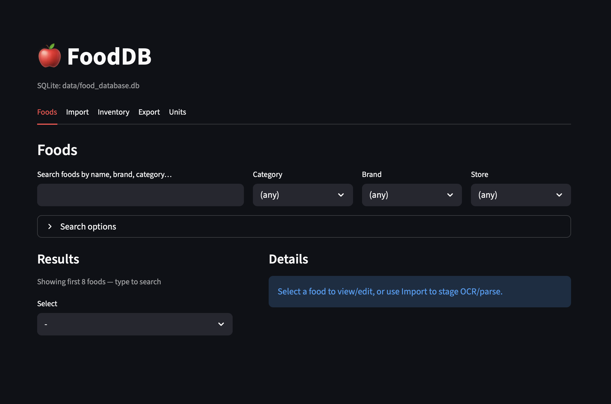

# FoodDB 🍎 — Local Nutrition Facts Database (SQLite + CLI + Streamlit + OCR)



FoodDB is a **local-first** personal nutrition-facts catalogue that stores food items in a portable **SQLite** database file and exposes CRUD via:

- **CLI** (`fooddb ...`)
- **Streamlit UI** (runs on local network)

Optional modules:
- **OCR** (pytesseract + OpenCV) to read nutrition labels from images (including **HEIC/HEIF** via Pillow + pillow-heif)
- **Text parsing** (regex-first) to convert label text into structured fields

---

## Features

- **Portable storage:** `data/food_database.db` (copy it anywhere)
- **Foods:** name, category, serving size/unit, macros, sodium, etc.
- **Variants:** store/brand/price/package size (Costco/Aldi/Walmart/Publix, etc.)
- **Units & conversions:** store common units + convert (g ↔ oz, etc.)
- **Import:**
  - paste label text → parse → save
  - image upload (jpg/png/webp/heic/heif) → OCR → parse → save
- **Single DB instance:** CLI writes are visible in the UI after refresh

---

## Repo layout (recommended)

```txt
FOOD_DB
├── data
│   ├── export.json
│   └── food_database.db
├── src
│   └── food_db
│       ├── cli
│       │   └── main.py
│       ├── config.py
│       ├── core
│       │   ├── models.py
│       │   ├── repository.py
│       │   ├── services.py
│       │   └── usecases.py
│       ├── infra
│       │   ├── db
│       │   │   └── sql_db.py
│       │   ├── nlp
│       │   │   └── processor.py
│       │   └── ocr
│       │       └── extractor.py
│       ├── ui
│       │   └── app.py
│       └── utils
│           └── conversions.py
├── tests
```

---

## Requirements

- Python (recommended: 3.11–3.13)
- `uv` for dependency + venv management
- SQLite (included with Python)

### Optional OCR requirements
- `tesseract` binary installed on your OS
- Python packages: `pytesseract`, `opencv-python`, `pillow`, `pillow-heif`

---

## Quickstart (uv)

```bash
cd food_db
uv venv
uv sync

# Initialize DB + seed base units
uv run fooddb db init
```

### Run Streamlit UI (local network)

```bash
# Run the UI (local network)
uv run streamlit run src/food_db/ui/app.py --server.address 0.0.0.0 --server.port 8501
```

Then open:
* On the same machine: http://localhost:8501
* On another device on your LAN: http://<your-ip>:8501

> Tip: To restrict access further, use a firewall rule or bind to a specific interface.

### CLI usage (examples)

```bash
# Add a food
uv run fooddb food add \
  --name "Greek Yogurt" \
  --brand "Fage" \
  --category "dairy" \
  --serving-size 170 \
  --serving-unit g \
  --calories 120 \
  --protein-g 20 \
  --carbs-g 6 \
  --fat-g 0

# Search foods
uv run fooddb food search "yogurt"

# Export
uv run fooddb export json --out data/export.json
uv run fooddb export --format csv  --out exports/foods.csv
```

## Enable OCR (including HEIC/HEIF) - OPTIONAL

Install OCR extras:

```bash
uv sync --extra ocr
```

> Note: `pytesseract` requires the **Tesseract** binary installed on your OS.

1) Install OS tesseract

    ```bash
    # macOS (Homebrew)
    brew install tesseract

    # Confirm
    tesseract --version
    ```
    If your tesseract binary is not in `PATH`, set it in `FoodOCRExtractor` (see below).

2) Install OCR dependencies via uv

    ```bash
    uv add pytesseract opencv-python pillow pillow-heif
    uv sync
    ```

3) HEIC/HEIF support

    HEIC/HEIF works by decoding via Pillow + pillow-heif, then converting to a temporary PNG before OCR.

    Implementation lives in: `src/food_db/infra/ocr/extractor.py`

    **Key behaviors:**

    * Uploading `.heic/.heif` in Streamlit works
    * OCR always reads a PNG/JPG path that OpenCV can decode

4) Configure tesseract path (macOS Apple Silicon)

    In `src/food_db/infra/ocr/extractor.py`:

    ```python
    tesseract_cmd: str | None = "/opt/homebrew/bin/tesseract"
    ```

--- 

### Notes on “refresh reflects CLI changes”

Both CLI and UI use the same SQLite file path from `food_db.config.settings.db_path`.

* CLI writes → SQLite file updates immediately
* UI reads from SQLite on refresh / rerun

If you change the DB path, do it in one place (config) so both clients stay consistent.

---

## Data model notes

- `foods` holds a **canonical product** (name, category, base serving, macros).
- `food_variants` holds store/brand variants (e.g., Costco vs Aldi) with price + package sizing.
- `units` stores conversion factors to grams.

---

## Future scope

* LLM integration (meal planning + macro balancing)
* Inventory forecasting (simple models / scikit-learn)
* Smart search (fuzzy matching + filters)
* UI dropdowns for brands/stores/units populated from DB