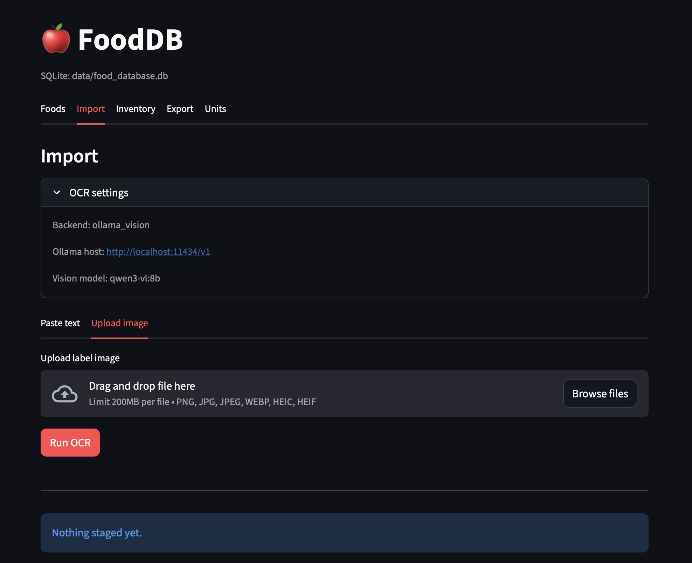

# FoodDB 🍎 — Local Nutrition Facts Database

A **local-first** personal nutrition catalogue backed by a portable **SQLite** file, with a full-featured **Streamlit UI** and **CLI** for CRUD, import, inventory tracking, and export.




---

## What it does

- **Store food items** with full nutrition facts (macros, micros, ingredients, best-by date)
- **Track store variants** — same food from Costco vs. Aldi vs. Publix with price and package size
- **Track inventory** — what you currently have on hand, per variant
- **Import from a label** — paste text or upload a photo (JPG/PNG/WEBP/HEIC/HEIF); regex parser extracts structured fields automatically
- **OCR two ways** — Tesseract (local, offline) or a local Ollama vision model (LLaVA/Qwen-VL style)
- **Fuzzy search** — token overlap + SequenceMatcher scoring; filter by category, brand, or store
- **Export** — JSON or CSV
- **Unit conversions** — stored conversion table (g ↔ oz, etc.) with a UI calculator

---

## Quick start

```bash
# 1. Clone and install
git clone <repo-url>
cd food_db
uv venv && uv sync

# 2. Initialize the database
uv run fooddb db init

# 3. Launch the UI (available on your local network)
uv run streamlit run src/food_db/ui/app.py --server.address 0.0.0.0 --server.port 8501
```

Open http://localhost:8501 in a browser. On another device on the same LAN, use `http://<your-ip>:8501`.

---

## CLI cheat sheet

```bash
# Add a food
uv run fooddb food add --name "Greek Yogurt" --brand "Fage" --category dairy \
  --serving-size 170 --serving-unit g --calories 120 --protein-g 20 --carbs-g 6 --fat-g 0

# Search
uv run fooddb food search "yogurt"
uv run fooddb food search "yogurt" --brand Fage --store Costco

# Add a store variant
uv run fooddb variant add --food-id 1 --store Costco --price 8.99 --package-size 907 --package-unit g

# Parse a label (text)
uv run fooddb parse text --text "Calories 90, Protein 3g, Total Fat 1g, Sodium 140mg"

# OCR a label image and save it
uv run fooddb parse ocr path/to/label.jpg --save

# Export
uv run fooddb export json --out data/export.json
uv run fooddb export csv  --out data/export.csv
```

---

## Optional: OCR setup

OCR is **opt-in**. Install the extras:

```bash
uv sync --extra ocr
```

### Tesseract (default, offline)

```bash
brew install tesseract          # macOS
# or: sudo apt-get install tesseract-ocr   (Linux)
```

If the binary is not on `PATH`, set it in `.env`:

```env
OCR_TESSERACT_CMD=/opt/homebrew/bin/tesseract
```

### Ollama vision model (alternative)

Run a vision-capable model locally (e.g., `qwen3-vl:8b`):

```bash
ollama pull qwen3-vl:8b
```

Then switch backends in `.env`:

```env
OCR_BACKEND=ollama_vision
OLLAMA_VISION_MODEL=qwen3-vl:8b
OLLAMA_HOST=http://localhost:11434
```

---

## Configuration (`.env`)

All settings are optional — defaults work out of the box.

| Variable | Default | Description |
|---|---|---|
| `DB_PATH` | `data/food_database.db` | SQLite file location |
| `OCR_BACKEND` | `tesseract` | `tesseract` or `ollama_vision` |
| `OCR_TESSERACT_CMD` | *(system PATH)* | Absolute path to tesseract binary |
| `OLLAMA_HOST` | `http://localhost:11434` | Ollama server URL |
| `OLLAMA_VISION_MODEL` | `qwen3-vl:8b` | Vision model name |
| `UI_HOST` | `0.0.0.0` | Streamlit bind address |
| `UI_PORT` | `8501` | Streamlit port |

---

## Requirements

- Python 3.11–3.13
- [`uv`](https://github.com/astral-sh/uv) for dependency management
- SQLite (included with Python)
- OCR extras (optional): see above

---

## Project layout

```
food_db/
├── data/                   # SQLite file and exports (git-ignored)
├── src/food_db/
│   ├── config.py           # Settings (pydantic-settings, .env support)
│   ├── cli/main.py         # Typer CLI
│   ├── core/
│   │   ├── models.py       # SQLAlchemy ORM + Pydantic schemas
│   │   ├── repository.py   # DB access layer
│   │   ├── services.py     # Service factory
│   │   └── usecases.py     # Parse + OCR orchestration
│   ├── infra/
│   │   ├── db/sql_db.py    # SQLite + SQLAlchemy session management
│   │   ├── nlp/processor.py # Regex-based label text parser
│   │   └── ocr/            # Tesseract + Ollama vision backends
│   ├── ui/                 # Streamlit app and pages
│   └── utils/              # Conversions, fuzzy search
└── tests/
```

For a deeper walkthrough of each layer, see [`docs/TECHNICAL.md`](docs/TECHNICAL.md).

---

## Data model (summary)

- **`foods`** — canonical product (name, category, brand, serving, full nutrition facts)
- **`food_variants`** — store/brand-specific entries with price and package sizing
- **`inventory_items`** — quantity on hand, linked to a variant
- **`units`** — conversion table (e.g., g ↔ oz)

---

## Future scope

- LLM-assisted meal planning and macro balancing
- Inventory forecasting (simple predictive models)
- Smarter fuzzy search (embeddings or BM25)
- Barcode scanning integration